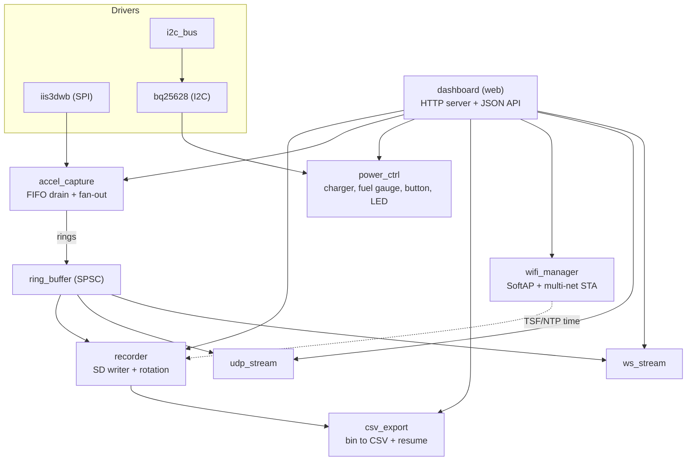
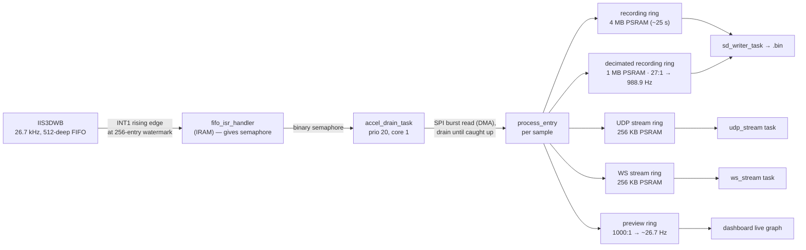
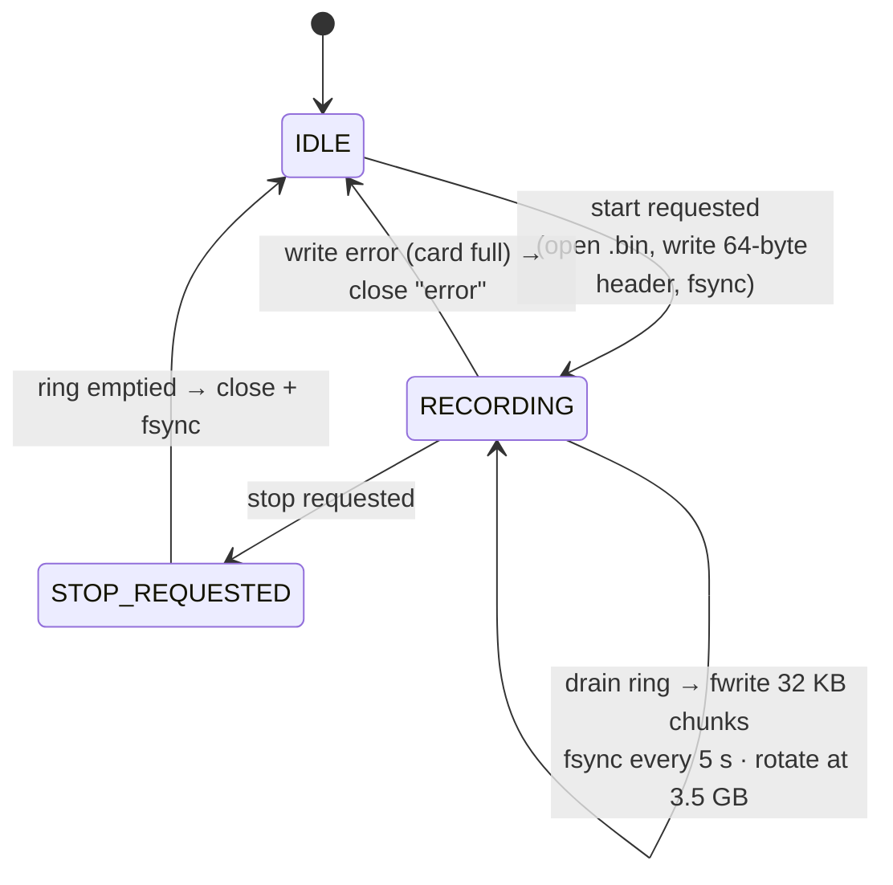
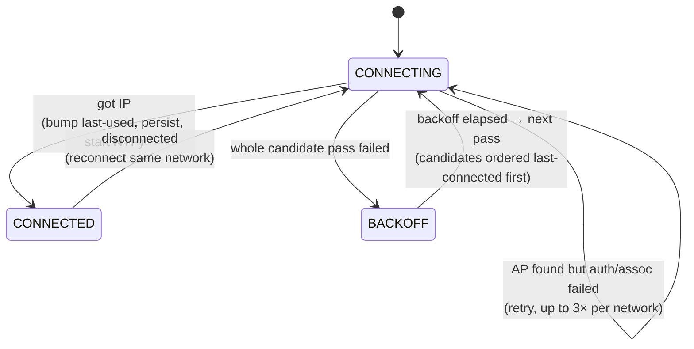
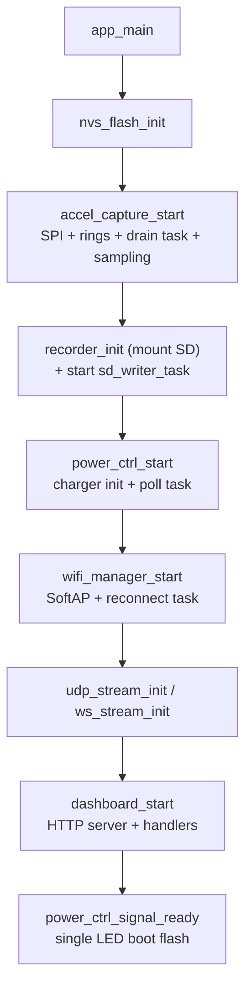
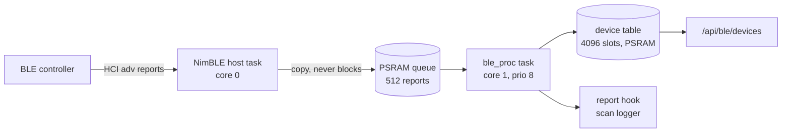
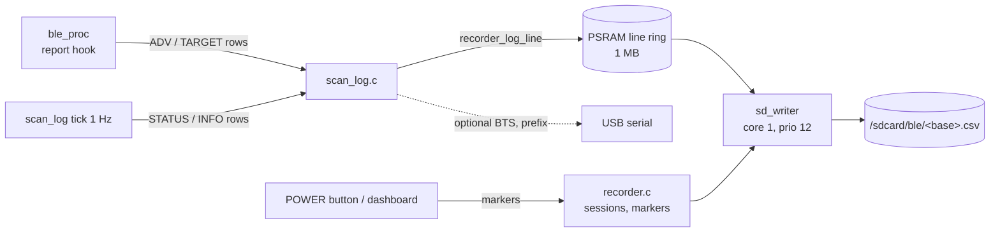
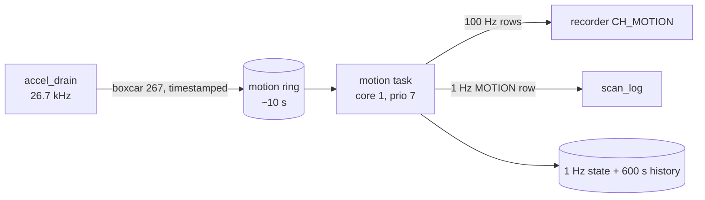

# BTScanner Firmware Architecture

Detailed architecture reference for the ESP32‑S3 vibration‑recorder firmware
(bachelor's thesis project). This document describes *how* the firmware is
built — its module structure, the real‑time acquisition pipeline, the
concurrency model, the on‑disk formats, and the networking/power subsystems —
at the level of detail needed to write about it or to onboard a new developer.

> **Inherited document.** This was written for the VibraShock vibration recorder,
> which BTScanner was forked from. Each section is rewritten as the matching
> subsystem is reworked for BLE scanning (see the README's work-in-progress
> note). Until then, a section describes the inherited recorder design.

> The Mermaid diagrams below render automatically on GitHub. For a designed,
> illustrated version see the companion HTML document.

## Contents

1. [Overview & design goals](#1-overview--design-goals)
2. [Hardware platform](#2-hardware-platform)
3. [Software stack & build](#3-software-stack--build)
4. [Module map](#4-module-map)
5. [The data‑acquisition pipeline](#5-the-data-acquisition-pipeline)
6. [Concurrency model](#6-concurrency-model)
7. [Recording subsystem](#7-recording-subsystem)
8. [On‑disk formats](#8-on-disk-formats)
9. [Networking & the web dashboard](#9-networking--the-web-dashboard)
10. [Multi‑network Wi‑Fi manager](#10-multi-network-wi-fi-manager)
11. [On‑device CSV export](#11-on-device-csv-export)
12. [Power management](#12-power-management)
13. [Boot sequence](#13-boot-sequence)
14. [OTA firmware updates](#14-ota-firmware-updates)
15. [Cross‑cutting design principles](#15-cross-cutting-design-principles)
16. [BLE scanner](#16-ble-scanner)
17. [Scan log and sessions](#17-scan-log-and-sessions)
18. [Motion profile](#18-motion-profile)

---

## 1. Overview & design goals

The firmware turns the board into a self‑contained, field‑usable vibration data
logger. Its single hard requirement drives the whole design: **capture the
IIS3DWB accelerometer at its full, fixed 26.7 kHz output data rate on all three
axes, without dropping samples, while simultaneously serving a web dashboard and
managing the battery.** Everything else is arranged around not disturbing that
real‑time path.

Design goals, in priority order:

- **Lossless full‑rate capture.** ~26 700 samples/s × 3 axes × 2 bytes ≈
  160 KB/s streamed to the SD card indefinitely, with hardware FIFO + DMA and a
  large RAM buffer absorbing any transient stalls.
- **Robustness in the field.** Survive power loss, a yanked SD card, a full
  card, brown‑outs, and a draining battery without corrupting recorded data.
- **Standalone operation.** No PC required: an always‑on Wi‑Fi access point and
  a web dashboard for control, a physical button for start/stop, and an LED for
  status when no screen is present.
- **Observability.** Live graphs, streaming, integrity counters, and a metadata
  sidecar per recording so a capture can be trusted (or its problems seen).

It is written in C against ESP‑IDF (FreeRTOS), no Arduino layer.

## 2. Hardware platform

| Component | Part | Interface | Role |
|---|---|---|---|
| MCU | ESP32‑S3‑WROOM‑1 (N8R8) | — | Dual‑core Xtensa LX7 @ 240 MHz, 8 MB flash, **8 MB PSRAM**, 2.4 GHz Wi‑Fi |
| Accelerometer | ST **IIS3DWB** | SPI (SPI2) | 3‑axis wideband vibration sensor, fixed 26.667 kHz ODR, ±2/4/8/16 g, 512‑deep FIFO, configurable second‑stage filter (off / low‑pass / high‑pass, 8 cutoffs) |
| Storage | microSD card | **SDMMC, 4‑bit, 40 MHz** | Raw `.bin` recordings + sidecars, FAT32 |
| Charger / PMIC | TI **BQ25628** | I²C | Li‑Po charger with on‑chip ADC (VBUS/VBAT/VSYS/IBAT/IBUS/T_die) and ship/shutdown modes |
| Status LED | single blue LED | GPIO (active‑low) | Blink‑pattern status vocabulary |
| Button | POWER (+ QON to charger) | GPIO | Gestures: double‑click = record, 3 s hold = ship mode |

The **8 MB of PSRAM is architecturally important**: all the large capture ring
buffers live there, keeping the ~512 KB of fast internal SRAM free for stacks,
DMA descriptors, and the Wi‑Fi/TCP stack.

## 3. Software stack & build

- **Framework:** ESP‑IDF 5.2.1 (FreeRTOS SMP, LWIP, `esp_wifi`, `esp_http_server`,
  FATFS/`esp_vfs_fat`, mDNS, `esp_eap_client` for WPA2/WPA3‑Enterprise, NVS).
- **Build system:** PlatformIO (`platformio.ini`), board `esp32-s3-devkitc-1`,
  custom 8 MB dual-OTA partition table (`partitions_ota.csv`).
- **Language:** C11, one translation unit per subsystem under `src/`, plus the
  board's register-level drivers under `src/drivers/` (see `SELFTEST_SPEC.md`
  for the hardware spec they target).
- **Web assets:** the UI is a **single-page app** in `dashboard.html` with
  Dashboard / Analyze / Recordings / Settings tabs; the former Live-FFT page is
  now the **Analyze** tab (its full-rate `/wsstream` connects only while that tab
  is open), and `live.html` is a thin redirect to `/`. Both are authored as
  normal HTML and **embedded into the firmware** as C string literals by
  `tools/gen_html_c.py` (producing `dashboard_html.c` / `live_html.c`), so the
  whole UI ships inside the binary — no filesystem serving of the app itself.

## 4. Module map

Each `src/*.c` file is one subsystem with a small public header. The producer of
all sample data is `accel_capture`; every other data consumer reads from it
through lock‑free ring buffers.



| Module | Responsibility |
|---|---|
| `accel_capture` | Owns the sensor + SPI; drains the FIFO on interrupt; fans each sample out to five ring buffers; decimation; self‑test; config (FS + second‑stage filter: off / low‑pass / high‑pass + cutoff) |
| `ring_buffer` | Generic byte‑oriented **single‑producer/single‑consumer** lock‑free ring |
| `recorder` | Mounts the SD card; the SD‑writer task; `.bin` format + header; rotation; periodic `fsync`; `.log` + 1 Hz `.aux.csv` sidecars; card‑detect monitor |
| `csv_export` | Background `.bin`→`.csv` conversion with free‑space pre‑check, atomic publish, crash‑resume, and cancel |
| `wifi_manager` | Always‑on SoftAP + a queue‑driven reconnect task managing up to 8 remembered networks (WPA2/WPA3 personal + enterprise); scan; NTP; mDNS |
| `power_ctrl` | BQ25628 charger config; coulomb‑counting fuel gauge; two‑stage low‑battery protection; POWER‑button gestures; LED pattern player |
| `dashboard` (web) | The `esp_http_server`; the `/api/*` REST endpoints; the status JSON builder; recordings listing/download/delete |
| `udp_stream` / `ws_stream` | Full‑rate live sample streaming over UDP / binary WebSocket |
| `sd_benchmark` | On‑demand SD write/read throughput test |
| `device_id` / `version` | Per‑board id (from factory MAC) and firmware identity, single source of truth |

## 5. The data‑acquisition pipeline

This is the real‑time heart of the firmware. The sensor is never polled on a
timer; it is **interrupt‑driven off its own FIFO watermark**, and the CPU only
ever does bulk DMA transfers, never per‑sample reads.



**Step by step:**

1. **FIFO watermark → interrupt.** The IIS3DWB is put in FIFO stream mode with a
   watermark of **256 entries** (half the 512‑deep FIFO — ~9.6 ms of slack).
   When the FIFO reaches the watermark it raises INT1; a rising edge fires
   `fifo_isr_handler`, an `IRAM_ATTR` ISR that does one thing: give a binary
   semaphore and yield.
2. **Drain task (highest priority in the system).** `accel_drain_task` (priority
   **20**, pinned to **core 1**) waits on that semaphore, then **burst‑reads the
   FIFO over SPI into a DMA‑capable scratch buffer** and loops *until the FIFO
   reports empty* rather than reading exactly one watermark's worth — if a
   backlog ever exceeds one burst, the watermark line may not produce a fresh
   edge, so the task pulls until `FIFO_STATUS` says nothing is left.
3. **Fan‑out.** For each sample, `process_entry` writes the raw `int16` X/Y/Z
   triplet into **five independent ring buffers**:
   - **recording ring** (4 MB PSRAM, ~25 s of buffering) — the full‑rate `.bin`.
   - **decimated recording ring** (1 MB PSRAM) — a 27:1 boxcar average of the
     raw codes → 988.9 Hz, for the optional low‑rate recording mode. (988.9 is
     deliberately not rounded: an integer decimation of a fixed 26.7 kHz rate
     rarely lands on a round number, and the *exact* value is what the recording
     header stores.)
   - **UDP stream ring** and **WS stream ring** (256 KB each) — full‑rate live
     streaming.
   - **preview ring** — 1000:1 boxcar decimation → ~26.7 Hz, converted to *g*,
     for the dashboard's live line graph.
4. **"Always fed, always drained."** Every ring is written unconditionally,
   whether or not anyone is consuming it; each consumer decides whether to keep
   or discard what it drains. This keeps an idle ring from silently backing up
   and then dropping the instant it *is* used. Short writes (ring full) are
   counted per‑ring as **drop counters**, surfaced in the UI.

**Integrity counters.** Two numbers tell you whether a capture is clean:
*sensor FIFO overruns* (the sensor's FIFO overflowed before we drained it — a
CPU/SPI‑starvation symptom) and *ring‑buffer drops* (our RAM buffer filled
because the SD card couldn't keep up). Both should be **0** for a good
recording, and both are written into the recording's `.log`.

## 6. Concurrency model

The firmware is a set of FreeRTOS tasks with **deliberate core pinning**: the
two cores are split by *purpose*, not load‑balanced.

- **Core 1 = the real‑time island.** The sample drain and the SD writer are
  pinned here so the Wi‑Fi/TCP stack (which runs on core 0) can never preempt or
  stall them. Because the ring producer (drain) and the ring consumers on this
  core share a core, the SPSC rings need only plain `volatile` indices — **no
  cross‑core memory barriers**.
- **Core 0 = networking & control.** Wi‑Fi, HTTP, streaming senders, power
  control, and the like.

| Task | Prio | Core | Purpose |
|---|---:|:--:|---|
| `accel_drain` | 20 | 1 | Drain the sensor FIFO on interrupt; fan out to rings |
| `sd_writer` | 12 | 1 | Pull the recording ring → `fwrite` to the `.bin`; rotation; `fsync` |
| `accel_st` | 10 | 1 | Built‑in accelerometer self‑test (transient) |
| `ws_push` | 6 | any | Push the ~26.7 Hz preview to dashboard WebSocket clients |
| `udp_stream` | 6 | 0 | Drain the UDP stream ring → UDP packets |
| `ws_stream` | 6 | 0 | Drain the WS stream ring → binary WebSocket frames |
| `power_ctrl` | 5 | 0 | ~50 ms button/LED loop + ~1 s charger/fuel‑gauge refresh |
| `wifi_reconnect` | 5 | any | Queue‑driven Wi‑Fi connection state machine |
| `ntp_sync` | 5 | any | One‑shot SNTP sync after joining a network (transient) |
| `sd_bench` | 4 | 1 | On‑demand SD throughput benchmark (transient) |
| `sd_cd_monitor` | 4 | any | Watch the card‑detect line; auto‑remount |
| `csv_export` | 3 | any | Background `.bin`→`.csv` conversion (transient) |
| *(httpd)* | — | 0 | `esp_http_server`'s own worker |
| `app_main` | — | 0 | Boot init, then idle |

**Synchronization primitives, and what each guards:**

- **Binary semaphore** (`s_fifo_sem`) — ISR → drain‑task wake‑up.
- **SPI mutex** (`s_spi_mutex`) — serializes *every* SPI transaction on the
  sensor, because the drain task polls it continuously while config changes,
  temperature reads, and the self‑test can land from other tasks. Without it,
  two concurrent polling transactions collide and the FIFO silently stops
  draining.
- **SPSC ring buffers** — lock‑free hand‑off from the drain task to each
  consumer.
- **Status mutex** (in `power_ctrl` and `wifi_manager`) — guards the shared
  status structs read by the HTTP task.
- **Message queue** (`wifi_manager`) — all `esp_wifi_connect/disconnect` calls
  and event reactions are funneled through one task via a queue, so the Wi‑Fi
  state machine has a single owner and no event races.
- **Stop‑done semaphore** (`recorder`) — signals a requested stop actually
  finished flushing/closing the file.

## 7. Recording subsystem

Recording is a small state machine owned by the **SD‑writer task**. Start/stop
requests from other tasks (the dashboard HTTP handler, the POWER button) set a
flag or state; the writer task acts on it on its next loop, so there is exactly
one task that ever touches the file.



Key mechanics:

- **Writer loop.** Reads up to **32 KB** at a time from whichever ring is active
  (full‑rate or decimated), `fwrite`s it, and — critically — *also* drains and
  discards the ring it is **not** using, honouring the "always drained"
  contract. When idle, it sleeps 20 ms between polls.
- **Durability: periodic `fsync`.** FATFS only commits a file's directory size
  and FAT chain on `f_sync`/`f_close`; data written with `fwrite` alone can be
  lost as an orphaned 0‑byte file on power loss. The writer therefore `fsync`s
  **every 5 s** (and writes+syncs the header immediately at open), so an
  ungraceful stop costs at most ~5 s of the in‑progress file, not all of it.
- **Rotation.** At **3.5 GB** the current file is closed and a new
  `<name>_partN.bin` is opened, staying under FAT32's 4 GB/file limit. Parts
  share a base name and are grouped back into one logical recording in the UI.
- **Fatal‑error handling.** A short `fwrite` (the classic ENOSPC "card full"
  signal, or any write error) stops the recording immediately with an `"error"`
  close reason rather than looping and losing data into a broken file.
- **Card‑detect monitor.** A separate task watches the card‑detect GPIO and
  auto‑remounts, so a re‑inserted card comes back without a reboot.

## 8. On‑disk formats

Each recording part produces sibling files in `/sdcard/rec/`: `<name>.bin` (raw
data), `<name>.log` (event sidecar), `<name>.aux.csv` (1 Hz side channels),
`<name>.mark` if markers were placed, and — after conversion — `<name>.csv`.
The folder also holds **`FORMAT.md`**, a terse description of all of these written
from a string compiled into the firmware (`s_format_doc` in `recorder.c`) after each
mount — only if missing or different, so it tracks firmware updates without a write
per boot. It must be updated with any format change (CLAUDE.md hard rule 6).

**`.bin` — a 64‑byte header, then a sync‑checkpoint table, then packed samples**
(`recording_format.h`):

| Offset | Field | Type | Notes |
|---:|---|---|---|
| 0 | `magic` | `char[4]` | `"VREC"` |
| 4 | `version` | `u16` | currently 3 |
| 8 | `sample_rate_hz` | `f32` | measured ODR (refreshed at close), or exact decimated rate |
| 12 | `fs_range_g` | `f32` | ±2/4/8/16 |
| 16 | `sensitivity_mg_per_lsb` | `f32` | to convert codes → g |
| 20 | `wall_time_valid` | `u8` | 1 if the start time is a real synced clock |
| 24 | `boot_time_us` | `i64` | uptime at start (always valid, monotonic) |
| 32 | `wall_time_unix_s` | `i64` | calendar start time if valid |
| 40 | `sync_table_bytes` | `u32` | bytes of sync table after the header (0 = v2, no table) |
| 44 | `sync_count` | `u32` | valid checkpoints in the table |
| 48 | `bssid` | `u8[6]` | AP the recording was on (shared‑clock scope; 0 if none) |
| 54 | `sync_interval_s` | `u16` | nominal checkpoint spacing |

**Sync table (v3):** immediately after the header, `SYNC_TABLE_ENTRIES` (512)
fixed 24‑byte slots of `{u64 sample_index, i64 tsf_us, u8 bssid[6], u8 rsvd[2]}` —
the 802.11 TSF (a µs clock shared by all devices on one AP) latched at start and
every ~60 s, tagged with the AP it came from. Lets recordings from multiple boards
be time‑aligned offline to ~µs: align on TSF using checkpoints whose `bssid`
matches (so a mid‑recording roam to another AP is handled — a `tsf_us == 0` / zero
`bssid` slot was taken while unassociated). Rewritten on each `fsync`, so a crash
keeps all but the last few seconds.

**Sample data** starts at `64 + sync_table_bytes`: little‑endian `int16` X, Y, Z
triplets, one per sample, **no per‑sample timestamps** (time is implicit from
index × sample period). So `sample_count = (file_size − 64 − sync_table_bytes) / 6`
— and a v2 file (`sync_table_bytes == 0`) reduces to the old `(size − 64) / 6`.

**`.log` — a plain‑text event sidecar** (one line per open/close), carrying the
capture settings and provenance so a file can always be traced and trusted:

```
start part=1 dev=VS-A1B2C3 fw=1.0.0 fs_g=2 rate_hz=26700.0 lpf2=off filter=off filter_hz=0 temp_c=29.6 overruns=0 drops=0
stop bytes=312219508 dur_s=1941.0 temp_c=34.4 overruns=51 drops=0
```

`dev`/`fw` identify the recording board and firmware; `temp_c` is logged at
start *and* stop (thermal drift); `overruns`/`drops` are the integrity counters.

**`.aux.csv` — slow side channels, one row per second** (plus one at the part's
start and end), written by the SD‑writer task (`aux_write_row` in `recorder.c`):
`sample_index,elapsed_s,accel_temp_c,mcu_temp_c,charger_temp_c,vbus_v,vbat_v,ibus_ma,ibat_ma,battery_pct,charging,rssi_dbm,lost_samples,drops,clipped_x,clipped_y,clipped_z`.
Kept out of the `.bin` on purpose: the sample block stays contiguous and the format
unchanged, and an at‑1 Hz table would need ~23 k reserved slots per file. Rows are
keyed by `sample_index` (like the sync table); empty field = value unavailable.
Cost is negligible by construction — power and Wi‑Fi values are cached status copies
(refreshed ~1 s by their own tasks), the accelerometer temperature is one short SPI
register read under the shared SPI mutex (the dashboard status already does the same
~1 Hz), the ESP32 die temperature is read by `power_ctrl`'s poll task on **core 0**
and only copied here — IDF reads that sensor inside a critical section (µs; ~300 µs
on a range switch), which must not mask interrupts on the real‑time core 1 — and
~150 B/s of text is flushed with the `.bin`'s own 5 s `fsync` (the 4 MB / ~25 s
recording ring absorbs any extra SD latency). The file stays
open for the whole part, so the SD mount allows 8 open files (was 6).

**`.csv` —** `sample_index,time_s,unix_time_s,x_g,y_g,z_g`, one row per sample
(`unix_time_s` blank when no wall clock was synced). Produced on‑device or
in‑browser (see §11).

## 9. Networking & the web dashboard

The device runs **SoftAP + STA concurrently**: a fixed‑SSID access point is
*always on* so the dashboard is reachable with no infrastructure at all (in the
field, on a bike), while the STA interface optionally joins existing Wi‑Fi.

- **HTTP server** (`esp_http_server`, `dashboard.c`): serves the embedded
  dashboard/live pages and a set of `/api/*` JSON endpoints (status, record
  start/stop, config, recordings list/download/delete, CSV export, Wi‑Fi
  select/forget/scan, charger/battery, streaming control). ~31 URI handlers;
  a `/api/status` poll (~1 Hz) drives the whole UI and returns one JSON blob
  covering chip/device, accel, recording, SD, charger, Wi‑Fi, and CSV‑export
  state.
- **Discoverability:** the STA interface sets a DHCP hostname and publishes an
  mDNS name (`btscanner.local`) so it's reachable by name across a subnet even
  where mDNS multicast doesn't traverse.
- **Time:** SNTP after joining a network; a browser‑supplied clock is a fallback
  (AP‑only mode) so recordings get real timestamps.
- **Live streaming**, two independent paths off their own rings so one never
  starves the other:
  - **Binary WebSocket** (`ws_stream`) — full‑rate to the browser live‑FFT page.
  - **UDP** (`udp_stream`) — full‑rate to a user‑supplied IP:port (e.g. a
    desktop analysis tool). Starting one stops the other (sending full‑rate data
    twice is pointless).
  - Plus the ~26.7 Hz **preview** WebSocket for the dashboard's line graph.

## 10. Multi‑network Wi‑Fi manager

`wifi_manager` behaves like a phone: it remembers up to **8 networks**
(WPA2/WPA3‑Personal and Enterprise), auto‑connects to whichever is in range
(last‑connected first), and handles password changes and roaming. The subtlety
is that **`esp_wifi` is event‑driven and not thread‑safe to drive from multiple
contexts**, so the whole thing is funneled through one task and a message queue:
the event handler only *forwards* events to the queue; the reconnect task is the
sole caller of `esp_wifi_connect`/`disconnect`.



- **Candidate ordering** is by a monotonic "last used" sequence — the most
  recently successful network is tried first, no RSSI pre‑scan (fast boot).
- **Effort where it counts:** an AP that's *found but fails* is retried a few
  times (a hiccup won't skip your in‑range network); an AP that isn't in range
  is skipped immediately. After repeated auth failures a network is flagged as
  "wrong password" but the manager **never gives up** — it keeps cycling with an
  escalating backoff that is **activity‑aware** (fast retries when the device is
  idle, longer backoff when a client/stream/recording is active, to keep the
  SoftAP smooth). The "wrong password" flag also **self‑heals**: after a few
  fully‑failed passes the flags are cleared so a network mis‑flagged on a
  transient/AP‑side refusal (a controller steering the client, a roam) gets a
  fresh full‑budget attempt instead of being stuck at one try per pass.
- **Optional AP pin:** normally the STA joins the strongest BSSID of its SSID; a
  device can be pinned to one **specific BSSID** (`sta.bssid_set`) so several
  boards share one AP for time‑aligned (TSF) recordings. It's a **soft** pin —
  honored on the first attempt, dropped on the retry — so an unreachable pinned
  AP falls back to a normal connect and can never strand the device. Stored in
  separate NVS keys (the saved‑network blob format is untouched); un‑pinned Wi‑Fi
  is unchanged. Set from Settings → Wi‑Fi via a per‑BSSID scan.
- **Persistence:** the network list is an NVS blob (SSID/credentials + last‑used
  counter), with LRU eviction by least‑recently‑connected when full.
- **Enterprise:** PEAP/TTLS‑MSCHAPv2 via `esp_eap_client`, username as both
  outer identity and inner user, no CA validation (matching typical phone setup).

## 11. On‑device CSV export

Converting a raw `.bin` to CSV on the device is a low‑priority background task
(`csv_export`), hardened for unattended use:

- **Free‑space pre‑check** (CSV is ~10–11× the raw size) — refuses up front
  rather than filling the card.
- **Atomic publish:** writes to `<name>.csv.tmp`, `rename`s to `.csv` only on
  success — a partial file never masquerades as finished. `fsync`s periodically.
- **Crash‑resume:** a tiny `<name>.csv.prog` checkpoint (last sample + byte
  offset) lets an interrupted conversion resume at boot from where it stopped
  (idempotent — re‑converting the overlap yields byte‑identical output). Resumes
  only below a ~2 GB ceiling (the platform's 32‑bit file‑offset limit for the
  back‑seek); larger interrupted jobs are dropped for a deliberate re‑run; a
  low battery at boot holds the resume for a manual choice.
- **Cancel** stops it and deletes the temp files.
- An **in‑browser** converter (a Web Worker in `dashboard.html`) is offered as
  an alternative — it downloads the `.bin` and builds the CSV client‑side,
  faster overall and offloading the device.

## 12. Power management

`power_ctrl` owns the BQ25628 charger over I²C and the physical UI (button +
LED), on a single ~50 ms poll task that also refreshes charger telemetry ~1 Hz.

- **Fuel gauge:** rather than mapping the flat Li‑Po voltage curve to state of
  charge, it **coulomb‑counts** the charge current (IBAT, integrated each ~1 s
  cycle) and self‑calibrates against two repeatable anchors — "just finished a
  real charge" (reset to 0 consumed) and crossing a fixed low‑voltage checkpoint
  (learn the cycle's capacity, EMA‑smoothed).
- **Low‑battery protection** (voltage‑based, debounced) — a **warning** plus a
  single hard cutoff, rather than a pre‑emptive timed shutdown:
  - **Warning** (~3.6 V on battery): informational only. The status bar shows
    "LOW" with the (smoothed) estimated time left, the dashboard shows a
    battery‑low banner, and the RGB LED gives a steady red pulse. The device
    **keeps running and recording** — the real 3.6 V→3.4 V runtime is long and
    hard to predict, and a fixed pre‑emptive shutdown only threw away usable
    runtime, so there isn't one. Hysteresis (clears at 3.7 V) stops it
    flickering around the threshold.
  - **Hard cutoff** (~3.4 V): the single automatic power‑off — a non‑overridable
    graceful shutdown to **shutdown mode**, which can only be woken by plugging
    in USB, so a nearly‑empty cell can't be button‑looped back into another
    low‑battery cycle. This is the real cell protection.
  - The runtime estimate that drives the warning and the dashboard is a slow
    EMA (~10 s), so it stays stable despite large per‑cycle current swings.
- **Battery‑presence detection:** the board can run battery‑less straight off
  USB, where the charger's VBAT pin floats near 0 V (and the fuel gauge would
  otherwise report a phantom 100 %). A **debounced VBAT hysteresis** (present
  ≥ 2.5 V, absent ≤ 2.0 V, each confirmed over ~5 s) decides presence — the wide
  gap and one‑sided margins mean a charger probe‑blip can't fake a cell and a
  real battery (which never sags near 2 V before the 3.4 V hard cutoff) is never
  misread as absent. With no cell, the battery‑derived signals are forced off:
  no gauge/percent, no "charging"/"on battery", no battery fault, and no
  low‑battery warning — the dashboard shows "no battery" instead.
- **Graceful shutdown** always stops/flushes any recording first (with a visible
  LED sequence) before commanding the charger's BATFET off.
- **Button gestures:** double‑click = start/stop a recording without a screen;
  3 s hold = ship mode (with an accelerating‑blink countdown).
- **LED pattern player:** a small non‑blocking engine plays a vocabulary of
  patterns (boot‑ready, recording heartbeat, stop‑saved, error, low‑battery),
  so the device is usable and legible with no dashboard open.

## 13. Boot sequence

`app_main` brings the subsystems up in dependency order, then idles.



Ordering matters in two places: the accelerometer's **GPIO interrupt is armed
before FIFO sampling is enabled** (otherwise the first watermark edge is missed
and the FIFO wedges full), and `power_ctrl`'s boot‑resume/battery logic waits
for a valid charger reading before acting.

## 14. OTA firmware updates

The firmware can be updated over the air — currently by uploading a `firmware.bin`
through the dashboard (a pull‑from‑URL path is a planned addition; see below).

**Partition layout.** OTA needs two app slots. The flash is laid out
(`partitions_ota.csv`, 8 MB) as:

| Partition | Type | Size | Purpose |
|---|---|---|---|
| `nvs` | data | 24 KB | settings (Wi‑Fi, toggles, battery learning) |
| `otadata` | data | 8 KB | records which app slot boots |
| `phy_init` | data | 4 KB | RF calibration |
| `ota_0` | app | 3 MB | app slot A |
| `ota_1` | app | 3 MB | app slot B |

The device runs from one slot and writes an update into the **other**; `otadata`
is flipped to boot the new slot only after the image is written and verified.
`nvs` is kept at the same offset as the old single‑app layout, so **settings
survive** the one‑time USB reflash that adopts this table. (The ~1.3 MB app has
ample headroom in a 3 MB slot.)

**Update flow** (`src/ota.c`, a deliberately source‑agnostic core so a
future URL‑pull path reuses it unchanged):
1. `ota_begin()` — refuses if a recording is active (flash writes stall the
   real‑time capture) or if there's no OTA partition; else `esp_ota_begin()` on
   the inactive slot.
2. `ota_write()` — streams the incoming bytes to that slot (fed today by the
   `POST /api/ota/upload` handler straight from the request body).
3. `ota_end()` — **verifies** the image, then `esp_ota_set_boot_partition()`.
4. The device reboots into the new slot.

**What the verification checks.** `esp_ota_end()` runs ESP‑IDF's image
validation over the freshly written slot: the image **magic byte** and header
structure, each segment's checksum, and — the meaningful one — a **SHA‑256 of
the entire image** that the build appends to the `.bin`. The hash is recomputed
from flash and compared, so a **corrupted, truncated, or non‑firmware file is
rejected** and never becomes bootable. The bootloader re‑verifies image
integrity again on the next boot before jumping to the app. This is an
**integrity** guarantee (you can't brick the device with a bad transfer), *not*
an authenticity one — see security below.

**Rollback.** With `CONFIG_BOOTLOADER_APP_ROLLBACK_ENABLE`, a freshly‑booted
update starts in `PENDING_VERIFY` state and is only made permanent once the
firmware calls `esp_ota_mark_app_valid_cancel_rollback()` — which
`ota_mark_valid()` does at the **end of `app_main`**, i.e. once boot has run to
completion. Crucially, boot is **tolerant of absent peripherals**: a missing SD
card or a detached accelerometer make their subsystem warn and continue rather
than abort, so `app_main` still reaches `ota_mark_valid()` and the update is
kept. The rollback "check" is therefore a pure **crash/liveness test** — not a
peripheral‑health or content check: only firmware that actually **panics/resets**
before that line stays `PENDING_VERIFY`, and the bootloader **reverts to the
previous slot**. So a broken *build* rolls back; a missing card or unplugged
sensor does **not**. (A genuine hang that never resets isn't caught
automatically — the common failure, a crash/panic, is.)

**How secure is it?**
- **Integrity: strong.** The SHA‑256 check reliably rejects bad/incomplete
  images.
- **Authenticity: none, by design (for now).** There's no signature check and
  the upload endpoint isn't authenticated, so anyone who can reach the device's
  network can flash any valid image. The threat is bounded by network access —
  the SoftAP is WPA2 — which is acceptable for a lab/field instrument. Raising
  it would mean **Secure Boot v2** (only cryptographically signed images run) +
  **flash encryption**, at the cost of one‑way efuses and key management —
  deliberately not enabled here; a lighter step would be an auth token on the
  upload endpoint.

**Adopting the layout.** Switching from the old single‑app table to dual‑OTA is
a partition‑table change, and you can't OTA *into* a new layout — so each device
needs **one final USB flash** (`pio run -e esp32-s3-selftest --target upload`).
After that, updates are wireless. The build also emits a blank
`ota_data_initial.bin`, so that USB flash starts OTA state clean.

**Update server & device‑address reporting** (`ota_cloud.c`, `device_report.c`).
The device can also *pull* updates from a user‑configured HTTPS endpoint — a
Cloudflare Worker fronting the GitHub releases — authed with Cloudflare Access
**service‑token** headers (`CF-Access-Client-Id/-Secret`) stored in NVS, never
compiled in. `GET <url>/version` returns the latest version + size; `GET
<url>/firmware` streams the image into the inactive slot through the same
`ota.c` core. The stored config is **sanitized on save** (a trailing `/` on the
base URL — which would double into `//version` → 404 — and a header label
accidentally pasted into a token field are both stripped). The download is also
retried as a whole if the stream drops mid‑transfer (an OTA write can't resume),
and mbedTLS runs with **dynamic buffers** (`CONFIG_MBEDTLS_DYNAMIC_BUFFER`) — the
firmware download was otherwise failing at the TLS handshake with
`MBEDTLS_ERR_SSL_ALLOC_FAILED` because the fixed 16 KB record buffer couldn't fit
in the fragmented internal heap; dynamic buffers grow/free it incrementally so the
handshake needs far less contiguous RAM.

`device_report.c` reuses that *same* endpoint and token to POST this board's
current local IP and a little status to `<url>/device/report` — on every new IP
(first connect and any later DHCP/AP change) and on a ~5‑minute heartbeat — so a
public `<url>/find/<device_id>` lookup can point a browser straight at
`http://<local-ip>/` on networks where mDNS doesn't reach. It's a self‑contained
low‑priority poll task: it reads existing Wi‑Fi/battery/recording state, detects
IP changes from `wifi_manager_get_status()`, and does a blocking TLS POST via the
shared `ota_cloud_post_json()` helper (a few connect retries for transient
failures; a non‑200 status is treated as definitive, logged, and retried later
with backoff). It **never touches the sampling/SD path**, and is a no‑op until an
update server is configured. A persisted "Send status reports" toggle (Settings →
Wi‑Fi, default on) can disable it entirely. The reported `device_id` is the
hostname's suffix (`btscanner-cc1588` → `cc1588`), so it always matches the
`/find` key.

## 15. Cross‑cutting design principles

A few ideas recur throughout the codebase and are worth naming:

- **"Always fed, always drained."** Every ring buffer is written
  unconditionally and drained by *someone* every loop, so no buffer silently
  backs up and then drops the moment it is first used.
- **One owner per resource.** The SD file (writer task), the SPI bus (mutex +
  single drain poller), and the Wi‑Fi state machine (single task behind a queue)
  each have exactly one owner, turning multi‑context races into ordinary
  sequential code.
- **Durability by default.** Periodic `fsync`, immediate header sync, atomic
  temp‑then‑rename for CSV, and graceful‑shutdown flushing all assume power can
  vanish at any instant.
- **Single source of truth.** The device ID (`device_id.c`, from the factory
  MAC) and firmware identity (`version.h`) are defined once and consumed by the
  About card, the boot log, and every recording's `.log`.
- **Real‑time first.** Core pinning, interrupt‑driven DMA capture, and the
  highest task priority in the system all exist to protect one invariant: the
  26.7 kHz stream never drops a sample.

## 16. BLE scanner

`ble_scanner.c` owns the Bluetooth side. NimBLE (host) and the ESP32‑S3 BLE
controller are brought up by `nimble_port_init()` after Wi‑Fi (the radio is
shared through the coexistence arbiter). Once the host syncs, one **extended
discovery** runs forever: scan interval = window = 50 ms on the 1M PHY (and,
if enabled, the Coded PHY), duration 0, **no duplicate filter**, accept‑all
filter policy, active or passive per setting. Legacy PDUs arrive through the
same extended‑report path, flagged as legacy.



- **GAP callback is copy‑only.** Each `BLE_GAP_EVENT_EXT_DISC` is copied into a
  `ble_report_t` (timestamps, address, RSSI, props, PHYs, SID, raw data) and
  queued with zero wait; a full queue increments `queue_drops`. The host task
  is never held up, because a slow host makes the controller discard reports.
- **Buffering.** Controller report flow control allows 400 unprocessed reports
  (`BT_CTRL_BLE_ADV_REPORT_FLOW_CTRL_NUM`), the host keeps 64 discardable event
  buffers (`BT_NIMBLE_TRANSPORT_EVT_DISCARD_COUNT`). Drops inside the controller
  are *not* visible to the firmware — IDF 5.2.1's NimBLE doesn't surface the
  controller's "adv lost" event — so `queue_drops` counts only host‑side loss.
- **Processing task** (core 1, below the accelerometer drain and SD writer)
  decodes the AD structures (`ble_adv_parse`: names, flags, TX power, service
  UUIDs, service data, appearance, manufacturer data), updates the device
  table, evaluates the optional target predicate and calls the report hook.
  It also runs the 1 Hz housekeeping (per‑device packet rates, "recent" count)
  and the **scan watchdog**, which restarts discovery whenever the host is
  synced but no discovery is active.
- **Device table.** Open‑addressing hash on address + type, 4096 slots in
  PSRAM. Names are cached per address (a complete name replaces a shortened
  one, packets without a name keep the cache). Random addresses rotate, so the
  number of distinct addresses grows without bound in busy places: at 3072
  entries the table is rebuilt keeping only the 2048 most recently seen.
- **Settings** (`ble` NVS namespace): `active`, `coded`; changing one restarts
  discovery immediately.
- **History.** Every device entry keeps its last 120 s (mean RSSI and packet
  count per second, written by the 1 Hz tick) and its last advertisement and
  scan‑response payloads (64 B each); the scanner also keeps a 600 s global
  history (reports/s, devices heard per second). That's why the table is
  2048 slots (~1 MB): purge at 1536, keep the newest 1024. List snapshots
  copy only the summary fields; `/api/ble/device` returns one full entry.
- **Targets.** `ble_scanner_set_target_fn()` is evaluated on every update;
  the hook's device copy carries `target_event` on the first match, after a
  30 s gap, or after `ble_scanner_rearm_targets()` (called at every session
  start, so each log lists the targets already present).
- **Wi‑Fi coexistence.** While Wi‑Fi is on, the arbiter gives it radio slots,
  so BLE gets less than 100 % air time. The 100 % scan mode (§17) stops Wi‑Fi
  while logging.

## 17. Scan log and sessions



- **Split of work.** `recorder.c` owns the card (mount, card‑detect, space),
  the session lifecycle (start/stop handshake, rotation, `.log` / `.mark`
  sidecars, fsync every 5 s) and the line buffer. It knows nothing about the
  CSV. `scan_log.c` owns the schema (header row, every row kind, the on‑card
  `FORMAT.md`), target rules, logging settings and a 1 Hz task. The recorder
  API keeps VibraShock's names (`recorder_request_start`, markers, errors),
  so the POWER button, LED and OTA guard didn't change.
- **Line buffer.** Producers on several tasks append whole lines under a
  recursive mutex — all or nothing, a full buffer counts a `log_drops` — and
  the SD writer is the only consumer. `s_accept` gates it: true only while a
  session is open. The writer opens the file, then (holding the mutex) sets
  `s_accept` and lets `scan_log_session_begin()` queue the START row, so no
  scan row can precede it; at the end `scan_log_session_end()` queues STOP and
  closes the gate before the final flush.
- **Rotation** at 1 GB happens only at a newline inside the chunk being
  written, so no row is split; every part starts with the header row.
- **Stack budget.** Event rows are formatted on the caller's stack (the POWER
  poll task has 4 KB): 512 B, falling back to the heap only for long info
  texts (START with many rules). ADV rows use a static 1.8 KB buffer on the
  single BLE processing task.
- **1 Hz task.** STATUS row while logging; clock watch (INFO `clock_set` on
  the first valid wall time, `clock_adjusted` on a >2 s jump against uptime);
  100 % scan mode: 5 s after a session starts, `wifi_manager_set_radio_enabled
  (false)` stops AP + STA through the Wi‑Fi task (reconnect logic ignores the
  resulting disconnects); session end turns it back on immediately.
- **Settings** live in `bts_log` (autostart, wifi_off, serial) and rules in
  `bts_targets` — new namespaces, so VibraShock's keys are never touched.
- **Two channels.** The recorder writes two line streams per session through
  the same code path: CH_SCAN (`<base>.csv`, 1 MB ring) and CH_MOTION
  (`<base>.motion.csv`, 128 KB ring, only if enabled). Each has its own parts,
  rotation, counters and accept gate; a failed motion open never stops the
  scan log, a failed write on either ends the session.

## 18. Motion profile



- **Feed.** `accel_capture.c` averages 267 raw samples (26.667 kHz → ~99.9 Hz)
  in g and timestamps each with the esp_timer time of its window centre. The
  sample time comes from the FIFO backlog at read time: the newest entry is
  "now", entry *i* is `(backlog − 1 − i)` periods older (period from the
  measured ODR). The old raw-recording rings are gone; the UDP/WS full-rate
  rings remain.
- **Sensor setup.** `motion_start()` applies BTScanner's own range (NVS
  `bts_motion`, default ±4 g) and forces the second-stage filter off via
  `accel_capture_set_config_transient()` — so nothing is written to
  VibraShock's `accel_cfg`, and a remembered VibraShock high-pass (which would
  remove gravity) can't break tilt or steps.
- **Per sample.** Gravity = 1 s low-pass of the vector; dynamic acceleration =
  sample − gravity. Its vertical part (projection on the gravity direction)
  goes into a 4 s ring (400 samples, PSRAM) for the rhythm detector; a gap in
  the feed (> 0.2 s) empties it. Its horizontal part, in a
  basis of the board's X axis projected onto the horizontal plane (Y if X is
  near vertical), feeds a 3 s covariance whose principal axis is the movement
  axis (0–180°, confidence = eigenvalue contrast).
- **Walking = rhythm, not peaks.** Once per second, the normalized
  autocorrelation of the 4 s window over lags 0.3–1.6 s; its best value is the
  `rhythm` (0–1). The strongest repetition is often the stride (left and right
  steps differ, especially in a pocket), so the period is halved when it is
  ≥ 0.75 s or its half also correlates ≥ 0.4. Walking starts after 3 s with
  rhythm ≥ 0.6 and activity ≥ 0.08 g, continues while ≥ 0.45 and ≥ 0.05 g, and
  ends after 3 s below. The activity floor matters: a board lying still can
  reach 0.7 on sensor noise. Cadence = 60 / step period; steps (and distance)
  accrue as cadence × time while walking, plus the 2 s it took to confirm.
  Step length = 0.40 · (mean peak-to-valley per step in m/s²)^¼ (Weinberg;
  0.47 is the waist-worn constant, a pocket swings more), clamped to
  0.3–1.4 m. (The earlier peak detector could lock up on a bounce right after
  a step — a confirmed-too-early peak was neither counted nor discarded — and
  froze the step count on real data.)
- **Per second.** Activity = RMS of the dynamic acceleration. State: walking
  as above; still after 2 s below 0.02 g; moving above 0.04 g (or right after
  walking); in between the state holds. Speed = step length × cadence
  (walking only; 0 still; unknown otherwise).
- **Verified offline** with the real `motion.c` (host gcc + stubs). On a
  recorded 55 min `.motion.csv` (board in a pocket/bag: walks, a drive,
  lying still): 223 s of walking in 8 walks at 90–125 steps/min and
  1.0–1.6 m/s, none while driving or lying still (the old detector: 0 s, step
  count frozen). Synthetic data: still, 110 and 90 steps/min walks (94 steps
  for ~92, cadence ±0.1), irregular handling (no walking), and a 60° tilted /
  30° turned board (axis matched the hand-calculated 164°; it needs ~10 s to
  settle after a large orientation change).
- **Limits.** No gyroscope or magnetometer: no absolute heading, the axis has
  a 180° ambiguity, and position isn't integrated (it drifts within seconds).
